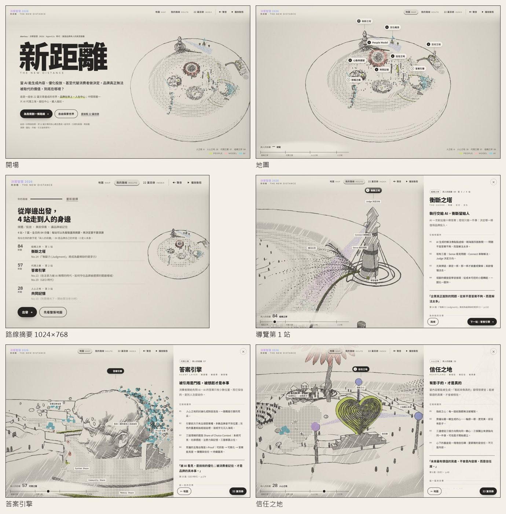
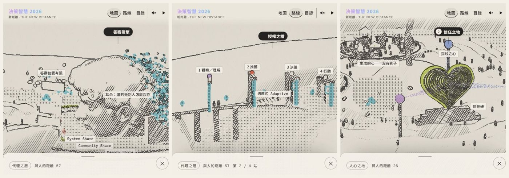

# 新距離 The New Distance

dentsu《決策智慧 2026｜Agentic 時代：重塑品牌與人的真實距離》的互動閱讀作品：把全書 22 篇文章畫成一座可以走進去的世界。

> 品牌與消費者之間，多了一層 AI。最外圈是品牌，中心是消費者；品牌的話、網友的評價，都先經過 AI。

**線上版：<https://dexterlee-ai.github.io/new-distance/>**



地圖分成三圈十區，每一區的名字直接說出它在談的事：

- **品牌**（最外圈）：判斷力、AI 內容產製、組織文化
- **AI**（中間）：AI 怎麼挑牌子、AI 能替人做到哪，以及站在 AI 這一圈島上的數位分身怎麼來、先問數位分身
- **消費者**（中心）：品牌怎麼被相信、品牌記憶、從想買到下單，圍著中心一座有人生活的廣場

點進任一區，畫面會先自己演一遍這一區在說的事——例如判斷力的 AI 幾秒就印出一大堆方案，但要由人挑一張蓋章、為結果負責——每一步的字幕接在畫面的關鍵動作之後出現，依序讀下來是一段有因有果的話；每一步都連到它在書裡的出處，按下就打開那一篇、捲到那一段。讀者也可以回答三題（角色、產業、最在意的事），跟著一條由品牌、經過 AI、走到消費者的路線讀。人做的東西用鉛筆排線畫，AI 做的東西用 ASCII 字元畫，數位分身是一個個「人」字；地圖預設印成「套色地圖」，鉛筆線底下印上 Riso 套色，故事的強調色只在讀者注視的那一區出現。



## 本機預覽

需要 Python 3，不需要安裝任何套件：

```bash
python tools/serve_world.py 5180
```

打開 <http://127.0.0.1:5180/>。也可以直接開 `#/map`（整張地圖）或 `#/index`（22 篇目錄）。地圖預設是套色地圖；網址加上 `?look=b`（微縮模型）、`?look=c`（黃昏）可以看另外兩個美術方向，`?look=0` 是它們共同的起點：只有鉛筆與字元的原稿。

## 專案內容

| 路徑 | 內容 |
|---|---|
| [`world/`](world/) | 作品本身：純靜態網站，整個資料夾即可部署，沒有建置步驟與第三方執行期依賴 |
| [`world/README.md`](world/README.md) | 完整說明：世界觀、策展原則、架構、AI 工具、製作流程、部署、資安自評、無障礙 |
| [`world/docs/intro-script.md`](world/docs/intro-script.md) | 3 分鐘介紹的旁白稿與分鏡 |
| `tools/build_world.py` | 由逐字全文資料產生 `world/data`，並檢查引文、註解、出處、字數與用詞；全部通過才寫入。執行 `python tools/build_world.py`（不加 `-I`：它需要的 fontTools 若裝在使用者的 site-packages，`-I` 會讓它載不到） |
| `tools/world_curation/` | 策展層：每篇的核心概念、案例與產業標籤、三圈與十個分區的文字、註解校正 |
| `tools/head_mesh.py`、`tools/subset_fonts.py` | 頭像網格處理、字型子集化 |
| `tools/serve_world.py` | 本機預覽伺服器 |
| `tools/verify_world.mjs` | 在無頭 Chrome 裡逐區、逐步、四種螢幕尺寸截圖並檢查（主角大小、文字與按鈕尺寸、標籤重疊、鏡頭規則、動畫可重現），例如 `node tools/verify_world.mjs --only core --sizes 390x844,430x760,932x430,1440x900 --out <輸出資料夾>` |
| `tools/chrome_lite.mjs` | 驗證與截圖腳本共用的無頭 Chrome：每次用一個臨時設定檔（不寫磁碟快取、不在背景下載），用完即刪；刪到一半被打斷的設定檔會留著標記，下一次啟動時清掉 |
| `tools/deploy_pages.sh` | 把已提交的 `world/` 發布到 `gh-pages` 分支（GitHub Pages） |
| `media/` | 本說明用的截圖（不部署） |

`world/data` 已是建置好的資料，網站可以直接執行。重新建置需要原刊逐字全文資料（`site/data`），它來自另一個版本的資料管線，不在這個 repository 裡。

## 部署

線上版由 GitHub Pages 提供：`gh-pages` 分支只放 `world/` 的內容，提交後執行 `sh tools/deploy_pages.sh` 即可重新部署。GitHub Pages 的限制、改用 Cloudflare Pages／Netlify 的作法與部署後的驗證步驟，見 [`world/README.md` §6–§7](world/README.md#6-部署)。

## 授權與出處

- 文章內容、圖表與原刊美術：dentsu Taiwan《決策智慧 2026｜Agentic 時代：重塑品牌與人的真實距離》，版權屬原出版者與各篇作者。
- three.js r185：MIT License（`world/assets/vendor/three.LICENSE.txt`）。
- 字型：Noto Sans TC、Montserrat、IBM Plex Mono，SIL Open Font License 1.1（`world/assets/fonts/OFL.txt`）。
- 配樂、音效與大衛頭像的 3D 網格以 Magnific 生成，細節見 [`world/README.md` §4](world/README.md#4-使用的-ai-工具)。
